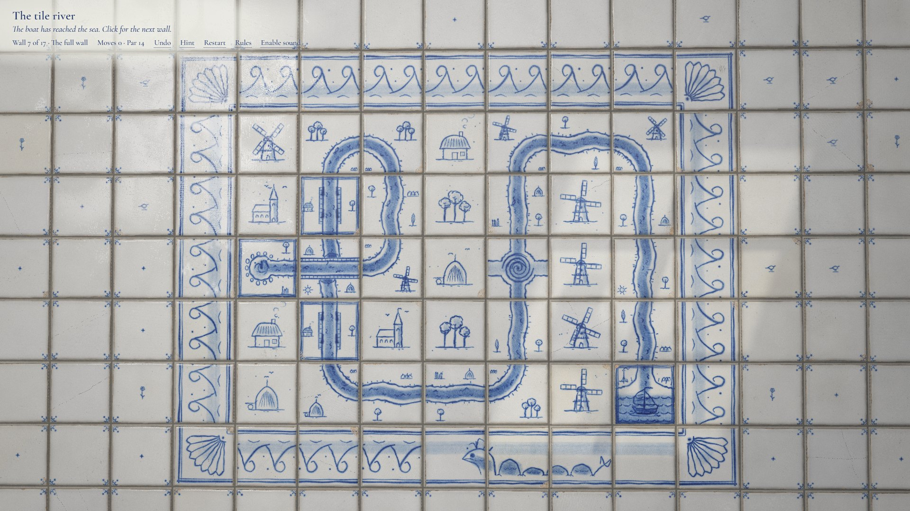
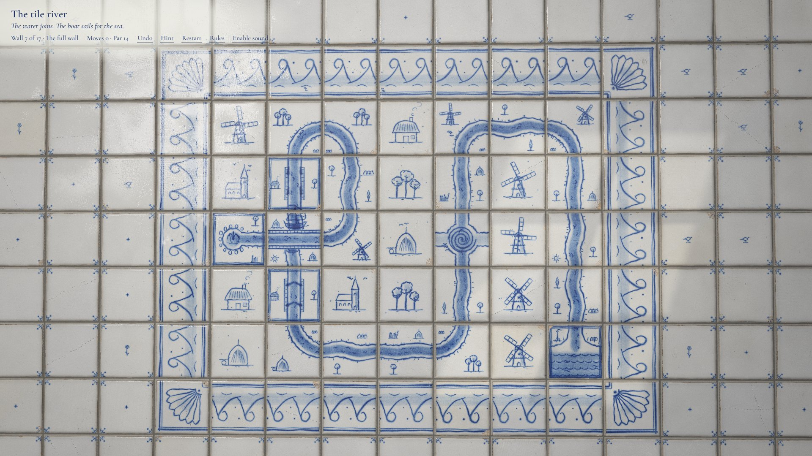
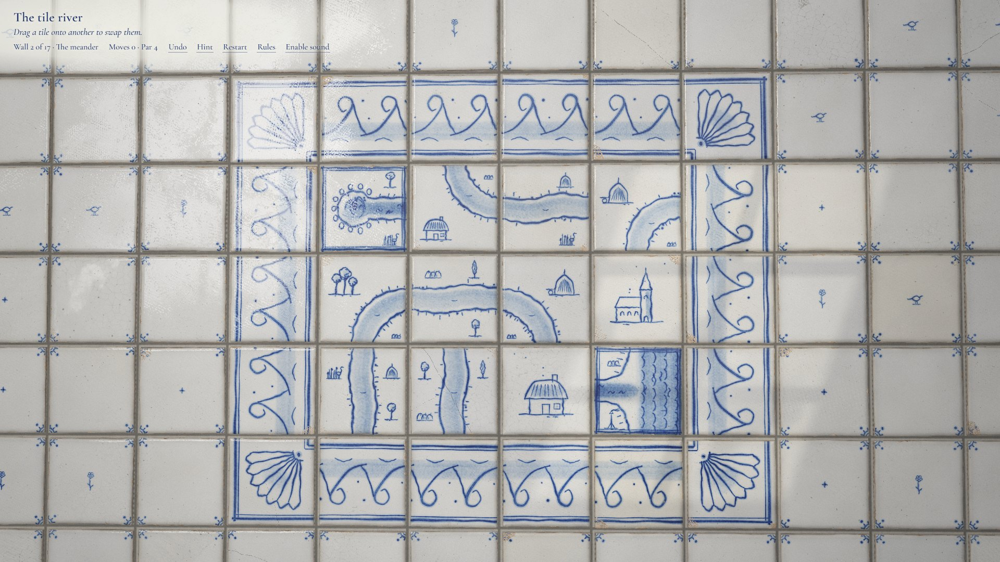
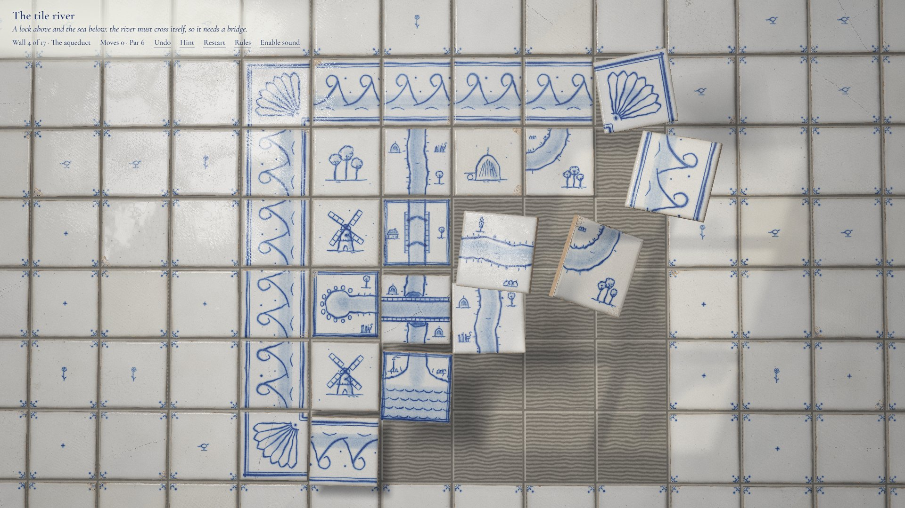
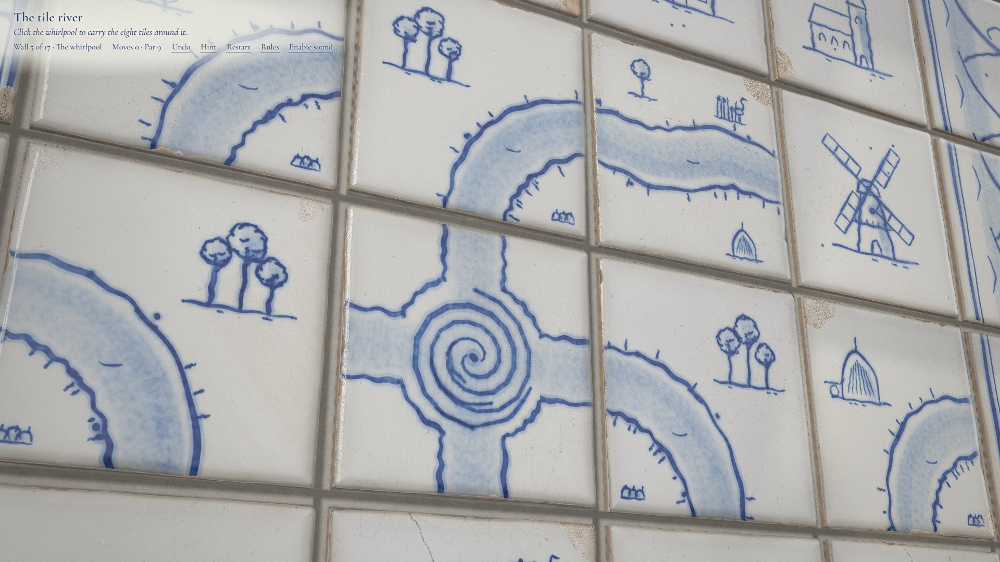
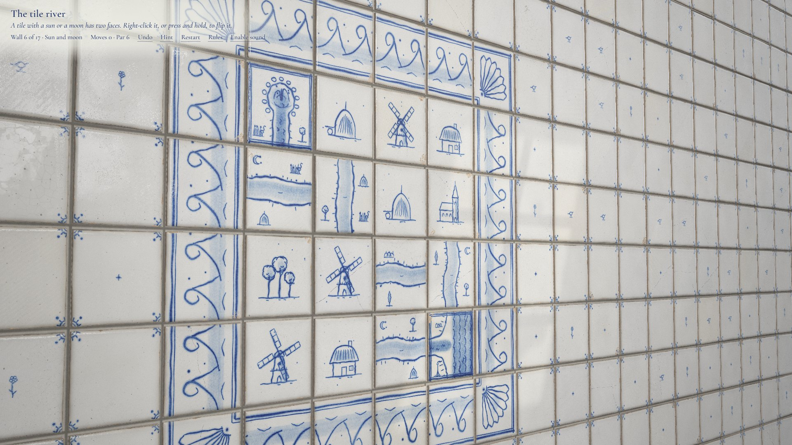

# The tile river

A puzzle game played on a wall of hand-painted tin-glazed tiles, cobalt blue on white, in the tradition of Portuguese and Dutch tiles. Turn and swap the tiles until the water runs from the spring to the sea. Then a painted sailing boat sets off along your river, and the painted world wakes as it passes.

**[Play it live at tile-river.vercel.app](https://tile-river.vercel.app/)**

[](https://tile-river.vercel.app/)

Everything you see is generated in code. Every tile face is painted stroke by stroke by a brush engine with pressure and pigment load. The glaze, crazing, pinholes, chips and grout come from shaders and generated maps, with no image files. The production build is a single standalone `index.html`.

## Play

- **Goal:** join the water from the **spring** (framed, with a fountain) to the **sea** (framed, with waves).
- **Click** a tile to turn it a quarter turn clockwise. **Right-click** turns it back. On a touch screen, **press and hold** does what a right-click does.
- **Drag** a tile onto another to swap them.
- **Right-click** (or press and hold, or **F** while hovering) flips a tile marked with a sun or a moon to its other face.
- **Click a whirlpool** to carry the eight tiles around it one place round.
- Framed tiles are set in mortar and cannot move. The river must pass straight through every lock.

The **Rules** link in the top line explains all of this in the game.

When the water joins, the boat sails the route. Windmills turn, fish jump, birds lift, chimneys smoke and a heron flies off. When the boat reaches the sea, a sea creature rolls along the bottom border.

Every turn, swap, flip and whirl counts as a move. The top line shows your moves, the wall's **par** and your best for that wall. Finish in par and the wall says **PERFECT!!** Undo takes a move back; restart sets the count to zero. Best scores are kept in your browser.

Par is the true fewest moves for that wall, by any river, not only the one it was designed around. Every idea a wall shows is needed to reach par: a bridge wall cannot be finished in par without crossing the river, a whirlpool wall without whirling, and so on. `npm run verify-levels` proves both for every wall (see Checks below).

On load the game plays itself in an attract mode, solving walls slowly. Click or press any key to take over at wall 1.

| Key | Action |
| --- | --- |
| Z or Backspace | Undo |
| H | Hint: the next wrong tile lifts and shows its move |
| R | Restart the wall |
| N / P | Next / previous wall |
| 1–9, 0 | Jump to walls 1–9, or 10 |
| F or Space | Turn, flip or whirl the tile under the pointer |

Sound starts muted. Click **Enable sound** to hear it. All sound is synthesised with WebAudio.



## The seventeen walls

Walls 1–6 each teach one idea and wall 7 brings them together. Walls 8–17 combine them on larger walls, ending on the largest.

| # | Wall | Idea |
| --- | --- | --- |
| 1 | The spring | Turning tiles |
| 2 | The meander | Swapping tiles |
| 3 | The lock | Locks are fixed, and the boat must pass every one |
| 4 | The aqueduct | A lock above and the sea below force the river to cross itself on a bridge |
| 5 | The whirlpool | A whirlpool turns the 3 × 3 block around it |
| 6 | Sun and moon | Tiles with two faces |
| 7 | The full wall | Everything at once, on a 7 × 5 wall |
| 8 | The long reach | Three locks hold a long river to its winding course |
| 9 | Two bridges | The river crosses itself twice |
| 10 | The lock flight | Three locks step the river down the hill |
| 11 | The mill race | A lock above a whirlpool |
| 12 | Night crossing | A two-faced tile hides a bridge |
| 13 | Twin whirlpools | Two whirlpools, each with its own ring |
| 14 | The polder | The river rings a field, crossing itself and passing two locks |
| 15 | Moon tide | Most tiles have two faces |
| 16 | The estuary | A bridge, three locks, a whirlpool and two-faced tiles |
| 17 | The great wall | The longest river: two bridges, five locks and a whirlpool, on an 8 × 6 wall |

<table>
  <tr>
    <td></td>
    <td></td>
  </tr>
  <tr>
    <td></td>
    <td></td>
  </tr>
</table>

## Run it

Tested on Node 24. `npm run verify-levels` runs a `.ts` file directly, so it needs a Node version with built-in type stripping.

```sh
npm install
npm run dev        # dev server with hot reload at http://localhost:5183
npm run build      # writes one standalone file: dist/index.html
npm run preview    # serves the build
```

`dist/index.html` opens directly from disk. Everything is inlined, including three.js and the favicon. The only network request it makes is for the Google Fonts title face, and it falls back to a local serif when offline.

### URL parameters

Useful for screenshots and for looking at exact moments:

| Parameter | Effect |
| --- | --- |
| `?t=<seconds>` | Runs the deterministic simulation to that time and freezes it |
| `?level=<1-17>` | Starts on that wall as the player, with no attract mode |
| `?view=close` | Low close-up camera |
| `?view=raking` | Raking camera across the glaze |
| `?view=sail` | The wall solved, the boat setting out (the last wall unless `?level` is given) |
| `?view=solved` | The boat arrived and the whole wall awake (likewise) |

For example: `?level=7&view=solved&t=2.4` gives the image at the top of this page.

## How it is made

The look follows a fixed set of rules for the medium:

- **One pigment.** The paint layers store only cobalt density. The shader turns density into colour by absorption, so a thin wash is pale blue and overlapping strokes go to deep indigo.
- **A brush edge, never a vector edge.** Strokes bleed softly into the glaze, pool darker at the rim and where the brush lands or lifts, and fade as the load runs out.
- **A real surface.** Milky glaze with a generated relief map, a net of craze lines, pinholes, kiln specks, thin glaze and grime at the edges, chipped corners down to the clay, hairline cracks, and a few replacement tiles from a creamier batch. Tile size, angle and tilt vary slightly.
- **Light from a room.** The glaze reflects a window. The reflection slides across the wall as the pointer moves and breaks at every tile, because each tile has its own tilt. A patch of low sun with leaf shadows drifts across the wall.
- **A painted film.** Anything that moves in paint (the boat, wavelets, waking scenery, the sea creature) is redrawn 10 times a second from alternating hands. The tiles move as physical objects: they lift, turn and clack back into place.

### Project layout

```text
index.html              entry, HUD, fonts
favicon.svg             tab icon (inlined into the build, also served as a file)
public/                 favicon.ico and apple-touch-icon.png, made by scripts/make-icons.mjs
vite.config.ts          single-file build
src/main.ts             boot, URL parameters, input, frame loop, dynamic resolution
src/game/               board rules, levels, solver (hint and attract), game controller
src/paint/              brush engine, tile painter, motifs, boat, sea creature, live layer
src/render/             wall of instanced tiles, glaze/grout/shadow shaders, surface maps
src/audio.ts            WebAudio sound
scripts/verify-levels.ts  proves every wall: solvable, unsolved at the start, par, every idea needed
scripts/rivers.ts       the searches behind par and the idea checks
scripts/design-walls.ts tries scramble seeds for a hand-drawn wall and keeps the ones that pass
scripts/check.mjs       headless Chrome: screenshots, fps, scripted play, dist check
docs/                   screenshots for this README
```

### Checks

```sh
npm run verify-levels   # each wall: solution reaches the sea through every lock, the
                        # scrambled start does not, the hint solver finishes it, the
                        # stored par is the proven minimum, and every idea on the wall
                        # is needed to reach par (takes a few minutes)
npm run typecheck
npm run dev             # then, in another shell:
node scripts/check.mjs play                          # scripted play-through with screenshots
node scripts/check.mjs fps "?level=7&view=solved"    # frame rate
node scripts/check.mjs shot name "?view=close"       # one screenshot (name.jpg for JPEG)
npm run build && node scripts/check.mjs dist         # standalone file: requests, errors, audio
```

How par is proven: a tile's turns and flips can happen before or after it is swapped, and whirlpool rings only move by whirling. So the cheapest way to make one given river run can be found exactly, by a branch-and-bound search over which tile ends in each river cell. Every finished wall has some river from the spring to the sea, so the verifier walks every river the tiles could form and keeps the cheapest. It then replays those moves on a fresh wall to confirm they work. On the smallest walls an exhaustive search over every possible move sequence gives the same answer.

The idea checks run the same search with one kind of move taken away (no crossings, no whirling, no flips or no swaps). If the wall can still be finished in par, that idea is decoration, and the check fails. The walls get past it by geometry. For example, a lock directly above a cell, with the spring feeding that cell from the side and the sea below it, leaves the water three sides of one tile to use. A tile carries water through only two sides per pass, so the river must pass twice, and only a bridge allows that. `scripts/design-walls.ts` then tries scramble seeds for a layout like that and keeps the starts that pass.

Screenshots go to `./shots` (set `SHOTS` to change it). The checks use the installed Chrome through `playwright-core`.

## Built with

[Vite](https://vite.dev) 8.3.8, TypeScript, [three.js](https://threejs.org) r186 with custom shaders, Canvas 2D for the brush engine, and WebAudio. The title face is Cormorant Garamond from Google Fonts.
